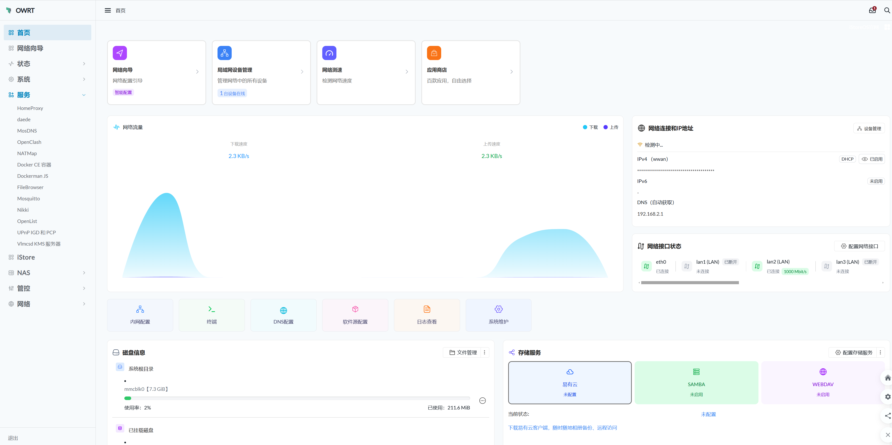
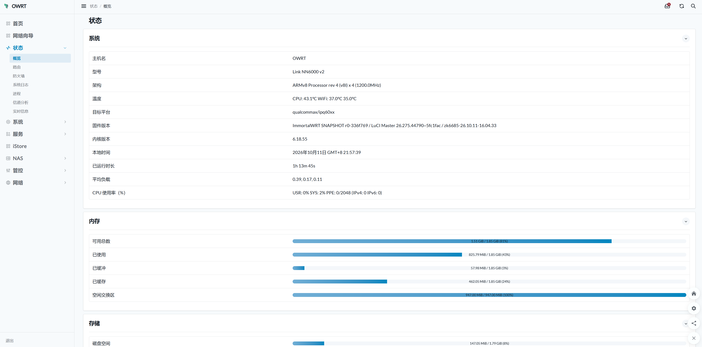

# zk-vikingwrt —— Link NN6000 定制 OpenWrt 云编译固件

本仓库 fork 自 [VIKINGYFY/OpenWRT-CI](https://github.com/VIKINGYFY/OpenWRT-CI)，针对 **Link NN6000 v1/v2**（`qualcommax / ipq60xx`）定制云编译，基于 [VIKINGYFY/immortalwrt](https://github.com/VIKINGYFY/immortalwrt)（`owrt` 分支）源码，编译完成后自动发布固件到 [Releases](https://github.com/zk6685/zk-vikingwrt/releases)。

## 主要修改特点

- **仅编译 NN6000 机型**：`Config/IPQ60XX-*.txt` 只保留 ipq60xx 段，`QCA-ALL.yml` 矩阵收敛为 WIFI-YES / WIFI-NO 两个 job，其余机型/workflow 停用。
- **内核分区 12M**：`Scripts/Handles.sh` 将 `link_nn6000-common` 的 `KERNEL_SIZE` 由 `6144k` 扩为 `12288k`。
- **版本标识**：发行描述改写为 `... / build by zk6685`。
- **内核开启 BTF（eBPF CO-RE）**：`CONFIG_DEBUG_INFO_BTF=y` + `CONFIG_KERNEL_BPF_EVENTS` / `CONFIG_KERNEL_XDP_SOCKETS` / `kmod-xdp-sockets-diag`，`dae`/`daed` 透明代理可直接运行，无需额外 `vmlinux-btf` 包。
- **daede 一体代理**：集成 `luci-app-daede`（同时管理 dae / daed 双内核），内置 v2ray geoip/geosite 软链。
- **istore 应用中心**：内置 `istorex` 首页 + `istore` 商店，并打上 **quickstart 温度修复补丁**（概览页显示 CPU 温度）。
- **Docker 容器支持**：docker/dockerd 引擎 + `luci-app-dockerman` / `luci-app-docker` 管理界面。
- **编译环境自愈修复**（`Scripts/Packages.sh` / `WRT-CORE.yml`）：补拉 `libdaemon` 包（snapshot feeds 注册异常）、修复 `UPDATE_PACKAGE` 多包仓库提取嵌套 bug。

## 集成插件列表

**代理 / DNS**：`luci-app-daede`（dae+daed）、`luci-app-openclash`、`luci-app-nikki`、`luci-app-homeproxy`、`luci-app-mosdns`、`luci-app-gecoosac`、`luci-app-openlist2`

**网络 / DDNS**：`luci-app-lucky`+`lucky`（动态域名 / 端口转发 / 反向代理）

**Docker**：`luci-app-dockerman`、`luci-app-docker`、`luci-lib-docker`、`docker`、`dockerd`、`containerd`、`runc`、`tini`

**istore**：`luci-app-istorex`、`luci-app-store`、`luci-app-quickstart`（含温度修复）、`taskd`、`luci-lib-taskd`、`luci-lib-iform`

**存储 / 网盘**：`luci-app-clouddrive2`（二进制版）、`luci-app-filebrowser-go`+`filebrowser`、`luci-app-samba4`

**主题**：`luci-theme-argon` + `luci-app-argon-config`

**系统 / 工具**：`luci-app-cpufreq`、`zram-swap`、`luci-app-vlmcsd`+`vlmcsd`、`luci-app-mosquitto`+`mosquitto-ssl`/`mosquitto-client-ssl`、`luci-app-quickfile`+`quickfile`、`luci-app-mini-diskmanager`、`luci-app-autoreboot`、`luci-app-partexp`、`luci-app-natmapt`、`luci-app-upnp`、`luci-app-wolultra`、`fullconenat`、`htop`、`iperf3`、`smartmontools`、`nvme-cli` 等

**内核 / 驱动（关键项）**：`kmod-xdp-sockets-diag`、`kmod-veth`、`kmod-nft-tproxy`、`kmod-wireguard`、`kmod-bonding`、`kmod-nft-*` 系列、`kmod-usb-*` 系列、`kmod-fs-btrfs` / `kmod-fs-ksmbd`

---

## 界面截图

**管理后台首页（istorex 风格）**：网络向导 / 局域网设备管理 / 网络测速 / 应用商店快捷入口，服务菜单集成 daede、OpenClash、Docker CE 容器、Dockerman、FileBrowser、Mosquitto、Nikki、Vlmcsd KMS 等，并展示网络流量、接口状态、磁盘信息与存储服务。

**状态 / 概览页**：系统信息（型号 Link NN6000 v2、CPU/WiFi 温度、固件版本 `ImmortalWRT SNAPSHOT r0-336f769 ... / zk6685-26.10.11-16.04.33`、内核 6.18.55）、内存占用与磁盘空间状态。

---

## 固件简要说明

固件每天早上5点自动编译（手动也可通过 Actions 触发）。

固件信息里的时间为编译开始的时间，方便核对上游源码提交时间。

目标：**QUALCOMMAX（IPQ60XX / NN6000）系列**。

## 目录简要说明

workflows——自定义CI配置

Scripts——自定义脚本

Config——自定义配置

---

## 上游信息

# 高质量<免费>交流群

[IPQ技术讨论群](https://qm.qq.com/q/v7nMhzB4oU)

# 高质量<付费>中转站

[LiBwrt-Ai](https://api.zipimg.cn/register?aff=LR7FSZ2ZZ4D3)

# 本地编译器

https://github.com/VIKINGYFY/OWRT-Tools.git

# 自用修改版插件

https://github.com/VIKINGYFY/packages.git

# OpenWRT-CI

官方版：

https://github.com/immortalwrt/immortalwrt.git

自用版：

https://github.com/VIKINGYFY/immortalwrt.git

# U-BOOT

高通版-沉心：

https://github.com/chenxin527/uboot-qsdk12.5-build.git

高通版-小猪：

https://github.com/1980490718/u-boot-2016.git

联发科-全新版：

https://github.com/VIKINGYFY/UBOOT-CI/releases

联发科-官方版：

https://drive.wrt.moe/uboot/mediatek

#

